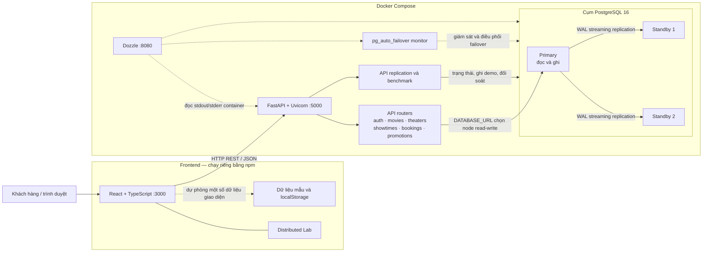

# MeoCinema — Đặt vé và demo hệ thống phân tán

MeoCinema là ứng dụng đặt vé xem phim gồm React/TypeScript (`FE/`), FastAPI (`BE/`), một cụm PostgreSQL 16 ba node và Dozzle để xem log. Dự án minh họa hai vấn đề khác nhau trong hệ thống phân tán:

1. **Consistency (nhất quán):** giữ đúng trạng thái nghiệp vụ khi nhiều request cùng lúc thay đổi dữ liệu. Ví dụ hai khách tranh một ghế thì chỉ một booking được xác nhận; hoàn vé hợp lệ phải trả ghế về trạng thái trống.
2. **Replication (sao chép):** giữ nhiều bản sao PostgreSQL cập nhật từ cùng một luồng ghi để có thể tiếp tục phục vụ sau khi một node lỗi và để kiểm tra dữ liệu đã truyền tới replica chưa.

Hai cơ chế bổ sung cho nhau: replication sao chép các thay đổi đã commit, nhưng tự nó không ngăn hai request đặt cùng ghế. Consistency được bảo vệ bằng transaction và ràng buộc duy nhất ở database; replication giúp các node giữ cùng dữ liệu và hỗ trợ chuyển primary khi có lỗi.

## Kiến trúc



### Thành phần và cách chúng phối hợp

- **Frontend:** React và TypeScript hiển thị giao diện đặt vé, gọi backend qua HTTP REST/JSON. Một số danh mục có dữ liệu mẫu dự phòng; thông tin giao diện như phiên đăng nhập và trạng thái ghế cục bộ có thể được giữ trong `localStorage`.
- **Backend:** FastAPI chạy bằng Uvicorn, cung cấp API cho đăng nhập, phim, rạp, suất chiếu, combo, khuyến mãi và booking. Router xử lý nghiệp vụ và truy cập dữ liệu PostgreSQL bằng `psycopg2`.
- **Cụm dữ liệu:** ba PostgreSQL node có một primary nhận ghi và hai standby nhận WAL từ primary. Backend nhận danh sách ba host trong `DATABASE_URL`; `target_session_attrs=read-write` giúp kết nối tới node hiện giữ quyền ghi.
- **Điều phối:** `pg_auto_failover` monitor theo dõi trạng thái data nodes và điều phối promote standby khi primary gặp sự cố. Sau khi vai trò node đổi, backend có thể kết nối lại qua danh sách host để tìm primary mới.
- **Distributed Lab:** giao diện gọi các endpoint demo ở backend để xem trạng thái/LSN node, ghi event, đối soát replication và chạy benchmark đặt vé đồng thời. Các kiểm tra replication này truy cập cụm PostgreSQL thật.
- **Quan sát log:** Dozzle đọc stdout/stderr của các container qua Docker socket ở chế độ chỉ đọc; nó dùng để xem log backend, PostgreSQL và monitor, không phải thành phần lưu dữ liệu nghiệp vụ.

Khi chạy, Docker Compose khởi động backend, monitor, ba data nodes và Dozzle; frontend được khởi chạy riêng bằng npm. Luồng đặt vé đi từ trình duyệt qua API đến PostgreSQL primary. Sau khi transaction được commit, PostgreSQL truyền WAL tới standby. Nếu primary dừng, monitor điều phối đổi vai trò và backend tìm node read-write mới qua cấu hình nhiều host. Các container trong bản demo cùng chạy trên một máy, nên kịch bản minh họa lỗi node/container và failover, không chứng minh khả năng chịu mất cả máy. Nếu monitor dừng, các node PostgreSQL hiện tại vẫn có thể tiếp tục hoạt động và replication, nhưng không có monitor để điều phối failover tự động mới.

Các thao tác đặt/hoàn vé và phần kiểm tra replication đều dùng PostgreSQL thật. Trong kịch bản đặt ghế, ràng buộc duy nhất ở database là lớp bảo vệ cuối cùng khi request đến đồng thời. Hoàn vé trước giờ chiếu chạy trong transaction, đánh dấu vé đã hoàn và giải phóng ghế; sau giờ chiếu bị từ chối. Cổng thanh toán thật chưa tích hợp, nên “hoàn tiền” là trạng thái nghiệp vụ trong ứng dụng.

## Cơ chế của ứng dụng

1. Trình duyệt lấy danh sách phim và suất chiếu từ API FastAPI.
2. API kết nối tới PostgreSQL node đang nhận ghi. `target_session_attrs=read-write` trong `DATABASE_URL` khiến libpq chọn host đang là primary, thay vì cố ghi vào standby chỉ đọc.
3. Khi đặt vé, backend tạo booking và các dòng ghế trong cùng transaction. Bảng `booking_seats` có ràng buộc `UNIQUE (showtime_id, seat_code)`. Nếu hai request cùng vượt qua bước kiểm tra ban đầu, PostgreSQL vẫn chỉ cho một request chèn cặp suất chiếu/ghế đó; request còn lại bị lỗi trùng khóa, rollback toàn transaction và trả lỗi ghế vừa được đặt.
4. Khi hoàn vé, backend khóa booking bằng `SELECT ... FOR UPDATE`, kiểm tra vé còn trả được và phim chưa bắt đầu, rồi trong một transaction xóa các dòng giữ ghế và chuyển trạng thái booking sang `refunded`. Nếu giao dịch lỗi, rollback giữ nguyên trạng thái cũ.

Vì thế **consistency** ở đây có nghĩa là các request đồng thời vẫn tuân theo quy tắc nghiệp vụ trong database: một ghế của một suất chỉ thuộc tối đa một booking đang giữ. Database là trọng tài cuối cùng; kiểm tra phía giao diện hoặc một biến trong bộ nhớ không đủ khi có nhiều request hay nhiều backend process.

## Vì sao có replication và nó chạy thế nào?

- Chỉ node **primary** nhận ghi. Khi PostgreSQL commit transaction, thay đổi được ghi thành WAL (Write-Ahead Log).
- Hai node **standby** nhận WAL qua physical streaming replication rồi phát lại WAL lên bản sao dữ liệu của mình. `pg_auto_failover` monitor theo dõi trạng thái các node, còn PostgreSQL thực hiện truyền và phát lại dữ liệu.
- Cụm đang dùng synchronous replication với `ANY 1`: primary chờ ít nhất một standby xác nhận WAL trước khi xác nhận commit. Điều này giảm nguy cơ mất các transaction đã xác nhận nếu primary gặp lỗi, nhưng có thể tăng độ trễ hoặc làm ghi chờ khi không còn standby đủ điều kiện.
- Nếu primary dừng, monitor điều phối một standby đủ điều kiện lên primary. Backend kết nối lại qua danh sách ba host và chọn node read-write mới. Trong lúc chuyển vai trò, một số request có thể tạm thất bại.
- Kịch bản replication ghi một event vào primary rồi đọc event ID trực tiếp từ từng node để quan sát WAL đã được áp dụng chưa. Kịch bản failover dừng một container PostgreSQL thật và xác nhận các node còn lại bầu/promote primary mới.

Replication giúp có bản sao sẵn sàng và giảm gián đoạn khi hỏng một node; nó **không phải backup**. Xóa nhầm dữ liệu, lỗi ứng dụng hoặc hỏng toàn bộ máy có thể ảnh hưởng tất cả node trong cụm. Ba node demo chạy cùng một máy nên chỉ minh họa lỗi node/container, không chứng minh chịu được mất máy vật lý.

## Yêu cầu và chạy ứng dụng

Cần Docker Engine, Docker Compose plugin, Node.js và npm. Tại thư mục gốc:

```bash
docker compose up -d --build
docker compose ps
```

Lần đầu, các node lấy base backup; nếu tiến trình đang ở bước `waiting for checkpoint`, PostgreSQL có thể tự tiếp tục sau checkpoint. Đợi `pg-node1`, `pg-node2`, `pg-node3` và `pg-monitor` healthy rồi chạy frontend:

```bash
cd FE
npm install
npm start
```

Mở:

| Thành phần | Địa chỉ |
|---|---|
| Frontend | http://localhost:3000 |
| Backend API | http://localhost:5000 |
| Swagger | http://localhost:5000/docs |
| Health | http://localhost:5000/api/health |
| Dozzle | http://127.0.0.1:8080 |
| PostgreSQL node 1 / 2 / 3 | `localhost:5432` / `localhost:5433` / `localhost:5434` |

Mở Distributed Lab bằng **Ctrl + Shift + L**. Để dừng ứng dụng, dùng `docker compose down`. Lệnh này giữ dữ liệu. Tránh `docker compose down -v` nếu cần giữ database.

## Xem log và trạng thái database

Dozzle là trang đọc log stdout/stderr của container, không phải nơi lưu hay thay đổi dữ liệu database. Mở http://127.0.0.1:8080 rồi chọn `meocinema_pg_node1`, `meocinema_pg_node2`, `meocinema_pg_node3` để xem log PostgreSQL/pg_autoctl; chọn `meocinema_pg_monitor` để xem quyết định trạng thái/failover; chọn `meocinema_backend` để xem lỗi API, booking và refund. Có thể theo dõi log database trực tiếp trong terminal:

```bash
docker compose logs -f --tail=100 pg-node1 pg-node2 pg-node3 pg-monitor
```

Theo dõi cả API và database trong một luồng:

```bash
docker compose logs -f --tail=100 backend pg-node1 pg-node2 pg-node3 pg-monitor
```

Xem lại log gần đây hoặc trạng thái container:

```bash
docker compose logs --since=10m --tail=200 backend pg-node1 pg-node2 pg-node3 pg-monitor
docker compose ps
```

Trong log, `primary`/`secondary` là vai trò node, `WAL`/`LSN` cho biết vị trí dữ liệu đang truyền/phát lại, `base backup completed` là standby vừa lấy bản sao nền, còn `caught-up`/`reached LSN` báo standby đã bắt kịp một mốc WAL. Cảnh báo DNS có thể xuất hiện lúc các container mới nhận địa chỉ mạng; cần xem tiếp trạng thái cuối cùng trong `pg_autoctl show state` để biết node đã về `secondary` hay chưa. Log giúp chẩn đoán, còn truy vấn SQL/API mới xác nhận số dòng dữ liệu.

Xem trạng thái failover do monitor ghi nhận:

```bash
docker compose exec pg-monitor pg_autoctl show state --pgdata /var/lib/postgres/pgaf
```

Xem node nào đang là primary, rồi kết nối `psql` đúng service đó. Sau lần khởi tạo/reset hiện tại, `pg-node2` đang là primary; trạng thái có thể đổi sau failover:

```bash
docker compose exec pg-monitor pg_autoctl show state --pgdata /var/lib/postgres/pgaf
docker compose exec pg-node2 psql -U postgres -d meocinema_db
```

Sau failover, thay `pg-node2` bằng service hiện được báo `primary`. Ứng dụng tự tìm primary nhờ `target_session_attrs=read-write` trong `DATABASE_URL`. Trong psql, xem dữ liệu booking:

```sql
SELECT booking_code, customer_phone, showtime_id, seat_numbers,
       payment_status, created_at
FROM bookings
ORDER BY created_at DESC
LIMIT 20;

SELECT showtime_id, seat_code, booking_id
FROM booking_seats
ORDER BY showtime_id, seat_code
LIMIT 50;
```

Thoát psql bằng `\\q`.

## Tài khoản thử nghiệm

Hệ thống cung cấp 10 tài khoản khách hàng thử nghiệm được tạo sẵn trong PostgreSQL và bộ nhớ backend. Tất cả 10 tài khoản đều dùng chung mật khẩu `MeoTest@2026`; có thể đăng nhập bằng email hoặc số điện thoại:

| Người dùng | Email đăng nhập | Số điện thoại | Mật khẩu |
|---|---|---|---|
| Khách thử nghiệm 1 | `khach1@meocinema.test` | `0901000001` | `MeoTest@2026` |
| Khách thử nghiệm 2 | `khach2@meocinema.test` | `0901000002` | `MeoTest@2026` |
| Khách thử nghiệm 3 | `khach3@meocinema.test` | `0901000003` | `MeoTest@2026` |
| Khách thử nghiệm 4 | `khach4@meocinema.test` | `0901000004` | `MeoTest@2026` |
| Khách thử nghiệm 5 | `khach5@meocinema.test` | `0901000005` | `MeoTest@2026` |
| Khách thử nghiệm 6 | `khach6@meocinema.test` | `0901000006` | `MeoTest@2026` |
| Khách thử nghiệm 7 | `khach7@meocinema.test` | `0901000007` | `MeoTest@2026` |
| Khách thử nghiệm 8 | `khach8@meocinema.test` | `0901000008` | `MeoTest@2026` |
| Khách thử nghiệm 9 | `khach9@meocinema.test` | `0901000009` | `MeoTest@2026` |
| Khách thử nghiệm 10 | `khach10@meocinema.test` | `0901000010` | `MeoTest@2026` |

> **Cách chứng minh tài khoản nhận vé trong Kịch bản 3:**
> Khi chạy kịch bản 3 với 10 clients tranh mua ghế, nếu client nào thắng (ví dụ Khách thử nghiệm 5), bạn chỉ cần mở trình duyệt, đăng nhập đúng tài khoản `khach5@meocinema.test` (mật khẩu `MeoTest@2026`), sau đó vào mục **"Vé của tôi"** để chứng minh vé vừa mua đã được lưu chính xác vào tài khoản của khách hàng đó.

Database hiện đã được reset: 23 phim, 13 suất chiếu, 3 tài khoản, không có booking mẫu hay ghế bị chiếm. Phim dùng poster từ danh sách MoMo của giao diện; trailer placeholder đã bỏ, trailer không có link phù hợp để trống.

### Cách 1: Reset nhanh — Chỉ xóa dữ liệu vé, GIỮ LẠI CÁC TÀI KHOẢN (Khuyên dùng)
Dùng script tự động tìm Primary và làm sạch dữ liệu đặt vé phát sinh, giữ nguyên toàn bộ 3 tài khoản khách hàng và danh mục phim:

```bash
./scripts/reset_db_keep_accounts.sh
```

Hoặc chạy lệnh SQL trực tiếp trên node Primary hiện tại:

```bash
docker compose exec -T pg-node2 psql -U postgres -d meocinema_db -c "TRUNCATE TABLE booking_combos, booking_seats, bookings RESTART IDENTITY CASCADE; DROP TABLE IF EXISTS replication_demo_events;"
```
*(Thay `pg-node2` bằng node đang là primary)*

### Cách 2: Reset toàn bộ nạp lại từ đầu
Nếu muốn xóa toàn bộ schema và nạp lại từ đầu từ file SQL:

```bash
docker compose exec -T pg-node2 psql -U postgres -d meocinema_db < BE/database.sql
```

Thay `pg-node2` bằng primary hiện tại nếu vai trò đã đổi.

## Kịch bản 1 — Hai khách tranh ghế rồi hoàn vé

Đây là luồng booking thật trong giao diện chính, không phải simulator:

1. Mở MeoCinema trên hai cửa sổ hoặc hai trình duyệt và đăng nhập hai tài khoản/số điện thoại.
2. Chọn cùng phim, cùng suất chiếu và cùng ghế; xác nhận đặt gần như đồng thời.
3. Một khách nhận booking thành công. Request còn lại bị từ chối vì ghế đã được giữ. Xem log backend và kiểm tra `bookings` cùng `booking_seats`; một ghế chỉ được gắn với một booking.
4. Vào **Vé của tôi** bằng tài khoản thắng, xem thời gian đặt và chi tiết vé, rồi bấm **Hoàn vé** trước giờ chiếu.
5. Xác nhận vé chuyển sang **Đã hoàn tiền**, dòng giữ ghế được xóa, ghế xuất hiện lại trên sơ đồ và có thể đặt tiếp. Sau giờ chiếu, backend từ chối hoàn vé.

## Kịch bản 2 — Replication thật và Tự động Failover khi Node gặp sự cố

Cụm database gồm 3 data nodes sử dụng **PostgreSQL Physical Streaming Replication** kết hợp **pg_auto_failover** và một node giám sát độc lập (`pg-monitor`).
Tab **PostgreSQL replication thật** (trong modal *Distributed Lab*) hiển thị role, WAL LSN và trạng thái online/offline bằng cách truy vấn trực tiếp từng node theo thời gian thực.

> ⚠️ **QUY TẮC CỐT LÕI (QUORUM RULE):**
> - Cụm 3 node hoạt động theo nguyên tắc đa số (Quorum: cần tối thiểu 2/3 node sống).
> - Khi diễn tập Failover, **CHỈ ĐƯỢC TẮT DUY NHẤT 1 NODE ĐANG LÀ PRIMARY**.
> - **Tuyệt đối không tắt cả 3 node cùng lúc**, vì nếu tắt cả 3 node thì toàn bộ cluster bị sập (Outage), không còn server nào để failover sang. (Nếu lỡ tắt cả 3, chạy: `docker compose start pg-node1 pg-node2 pg-node3` để khởi động lại).

---

### Các bước thực hiện chi tiết

#### Bước 1: Kiểm tra trạng thái cụm trước diễn tập
Chạy lệnh kiểm tra từ Monitor:
```bash
docker compose exec pg-monitor pg_autoctl show state --pgdata /var/lib/postgres/pgaf
```
Hoặc mở giao diện web (`http://localhost:3000`) -> bấm **Distributed Lab (Chương 7)** -> chọn tab **PostgreSQL replication thật**.
Xác định node nào đang giữ vai trò **`primary`** (ví dụ: `pg-node3` hoặc `pg-node1`). Hai node còn lại sẽ có vai trò **`secondary`**.

---

#### Bước 2: Thử nghiệm ghi dữ liệu và đồng bộ Replication (Sync check)
Bấm **"Ghi bản ghi demo vào Primary"** trên giao diện Lab, rồi bấm **"Kiểm tra trên các node"**.
Hoặc chạy lệnh từ terminal:
```bash
curl -s -X POST http://localhost:5000/api/distributed/replication/real/demo-write \
  -H "Content-Type: application/json" \
  -d '{"message": "Kiem tra ghi replication truoc khi failover"}'
```
*Kết quả:* Event ID và WAL LSN xuất hiện đồng nhất trên cả 3 nodes (Node Primary xác nhận sau khi Standby đã nhận WAL).

---

#### Bước 3: Giả lập sự cố chết Node Primary (Simulate Primary Crash)
Tắt đúng container của Node đang là Primary (ví dụ nếu `pg-node3` đang là primary):
```bash
docker compose stop pg-node3
```
*(Nếu primary là `pg-node1` thì thay bằng `pg-node1`)*.

---

#### Bước 4: Quan sát Monitor tự động bầu chọn Primary mới (Automatic Failover)
Chờ khoảng 5-10 giây để monitor phát hiện heartbeat timeout, sau đó kiểm tra lại trạng thái:
```bash
docker compose exec pg-monitor pg_autoctl show state --pgdata /var/lib/postgres/pgaf
```
**Cơ chế diễn ra:**
1. Node bị tắt chuyển sang trạng thái mất kết nối `read-write !` -> `demote_timeout` -> `demoted`.
2. `pg-monitor` tự động chọn Standby có LSN mới nhất (ví dụ `pg-node2`) và cấp lệnh `prepare_promotion` -> `primary`.
3. Standby được promote chính thức thành **Primary mới** (mở cổng ghi).
4. Backend và giao diện web tự động định tuyến các giao dịch ghi mới vào Primary mới mà không cần can thiệp thủ công (Zero Downtime / Zero Manual Intervention).

---

#### Bước 5: Hồi sinh Node cũ (Node Recovery & Re-join)
Khởi động lại container vừa bị tắt:
```bash
docker compose start pg-node3
```
Chờ 3-5 giây và kiểm tra lại:
```bash
docker compose exec pg-monitor pg_autoctl show state --pgdata /var/lib/postgres/pgaf
```
**Kết quả:**
- Node cũ tự động kết nối lại vào cụm dưới vai trò **`secondary` (standby)**.
- `pg_autoctl` thực hiện `catchingup` để đồng bộ bù toàn bộ WAL logs phát sinh trong lúc node bị tắt.
- Cụm phục hồi về trạng thái chuẩn hoàn hảo: **1 Primary mới + 2 Secondary**, LSN giữa các node tiếp tục đồng nhất.

---

### Bảng tra cứu lệnh nhanh cho Kịch bản 2

| Mục tiêu thao tác | Lệnh thực thi |
| :--- | :--- |
| **Xem trạng thái chi tiết 3 node** | `docker compose exec pg-monitor pg_autoctl show state --pgdata /var/lib/postgres/pgaf` |
| **Ghi thử 1 event replication** | `curl -s -X POST http://localhost:5000/api/distributed/replication/real/demo-write -H "Content-Type: application/json" -d '{"message": "Test"}'` |
| **Giả lập chết Primary** | `docker compose stop <node-primary>` *(ví dụ `docker compose stop pg-node3`)* |
| **Bật lại Primary đã dừng** | `docker compose start <node-primary>` *(ví dụ `docker compose start pg-node3`)* |
| **Cứu hộ (khi lỡ tắt cả 3 node)** | `docker compose start pg-node1 pg-node2 pg-node3` |

---

### Hai kiểu replica khi primary gặp lỗi

- **Ghi đồng bộ (Synchronous Replication):** Primary chỉ xác nhận commit sau khi ít nhất một standby xác nhận đã nhận WAL. Đổi lại độ an toàn dữ liệu tuyệt đối (RPO = 0), tránh mất dữ liệu khi failover.
- **Đọc từ replica (Read-Your-Writes):** Standby phục vụ truy vấn đọc. Với các nghiệp vụ đặt vé quan trọng, backend MeoCinema đảm bảo tính nhất quán Đọc-sau-Ghi (Read-Your-Writes) để tránh đọc phải dữ liệu trễ (Stale Read).

## Kịch bản 3 — Bão đặt vé đồng thời và nhất quán sao chép trên cụm

Kịch bản này tích hợp và chứng minh đồng thời cả hai thuộc tính sống còn của hệ phân tán: **Transaction Consistency (ACID / Linearizability)** khi có nhiều request tranh chấp cùng lúc và **Replication Consistency (Read-Your-Writes)** trên toàn bộ cụm PostgreSQL.

### Cách thức hoạt động

1. **Transaction Consistency (Nhất quán giao dịch / Chống Double-Booking):**
   - Hệ thống mô phỏng $N$ khách hàng (5, 10, hoặc 20 clients) cùng lúc bấm xác nhận đặt đúng một ghế VIP (ví dụ `VIP-F8`) tại cùng một microsecond.
   - Các thread được đồng bộ hóa bằng `Barrier` và gửi đồng thời đến Primary.
   - Nhờ ràng buộc duy nhất trong PostgreSQL `UNIQUE (showtime_id, seat_code)` và mức cô lập giao dịch, database chỉ cho phép **đúng 1 request commit thành công (200 OK)**.
   - $N - 1$ requests còn lại ngay lập tức bị lỗi xung đột khóa duy nhất, nhận mã lỗi `409 Conflict` và toàn bộ transaction được rollback an toàn.
   - Số lượng ghế bán vượt quá (Overbooking) bằng 0 tuyệt đối.

2. **Replication Consistency & Read-Your-Writes (Nhất quán sao chép trên cụm):**
   - Ngay sau khi transaction thắng cuộc được commit trên Primary, backend truy vấn đối soát tức thời trực tiếp trên tất cả các node trong cụm (`pg-node1`, `pg-node2`, `pg-node3`).
   - Kiểm tra mã vé và trạng thái ghế `VIP-F8` trên từng node kèm WAL/Replay LSN. Cả 3 node đều phản ánh trạng thái đã giữ ghế và mã vé trùng khớp 100%.
   - Thử nghiệm đọc sau ghi: Thực hiện truy vấn đọc chi tiết vé trực tiếp từ một **Standby Replica**. Khách hàng nhận được đầy đủ thông tin vé hợp lệ của mình mà không bị mất dữ liệu hay đọc phải bản ghi cũ (Stale Read).

### Cách thực hiện demo

**Cách 1: Trực quan trên Giao diện Web (Distributed Lab Modal)**
1. Nhấn tổ hợp phím **Ctrl + Shift + L** để mở cửa sổ **Distributed Lab**.
2. Chọn tab **Kịch bản 3: Tranh ghế & Nhất quán sao chép**.
3. Chọn số lượng clients đồng thời (5, 10, hoặc 20 requests) và mã ghế thử nghiệm (mặc định `VIP-F8`).
4. Bấm **Chạy kiểm thử (10 requests)**:
   - Xem thống kê giao dịch: 1 Thắng (200 OK), 9 Xung đột (409 Conflict).
   - Xem bảng đối soát 3 node: Cả `pg-node1`, `pg-node2`, `pg-node3` đều báo `ĐỒNG BỘ 100%`.
   - Xem khối xác nhận **Read-Your-Writes Consistency** đọc từ Standby replica.
5. Bấm **Dọn dẹp ghế** để giải phóng ghế thử nghiệm và chạy lại kịch bản bao nhiêu lần tùy thích.

**Cách 2: Chạy trực tiếp qua dòng lệnh Terminal (CLI)**
```bash
# Chạy với 10 clients mặc định tranh ghế VIP-F8
python3 scripts/demo_concurrency_replication.py

# Hoặc tùy chỉnh 20 clients tranh ghế VIP-G8
python3 scripts/demo_concurrency_replication.py --concurrency 20 --seat VIP-G8

# Giải phóng ghế sau khi test
python3 scripts/demo_concurrency_replication.py --cleanup --seat VIP-G8
```

## API cho kịch bản replication

| Mục đích | Endpoint |
|---|---|
| Vai trò, trạng thái và LSN của từng PostgreSQL node | `GET /api/distributed/replication/real/status` |
| Tạo event thật qua primary | `POST /api/distributed/replication/real/demo-write` |
| Đọc event ID trực tiếp trên mỗi node | `GET /api/distributed/replication/real/verify/{event_id}` |
| Chạy kịch bản bão request tranh ghế & đối soát replication | `POST /api/distributed/replication/real/benchmark/concurrent-booking` |
| Dọn dẹp / giải phóng ghế sau khi benchmark | `POST /api/distributed/replication/real/benchmark/cleanup` |

Các log container ở Dozzle/stdout khác với những endpoint log simulator còn lại của backend.

## Xử lý sự cố

### Backend chưa kết nối được database

```bash
docker compose ps
docker compose logs --tail=100 pg-monitor pg-node1 pg-node2 pg-node3 backend
```

Đợi một primary sẵn sàng; backend có bước chờ database khi khởi động. Có thể kiểm tra API health tại `/api/health`.

### Replica đang khởi tạo base backup

Theo dõi `docker compose logs -f pg-node2 pg-node3` và `pg_autoctl show state`. Không xóa volume khi đang khởi tạo. Dữ liệu mỗi node và cấu hình keeper được lưu trong named volumes.

### Một node bị dừng sau demo

Chạy `docker compose start <service>` và đợi monitor đưa node trở lại cụm. Xác nhận trạng thái có một primary và các node còn lại là secondary trước khi chạy demo kế tiếp.

### Frontend không mở được

Kiểm tra `npm start` còn chạy trong `FE/`, backend ở cổng 5000 và frontend ở cổng 3000.
