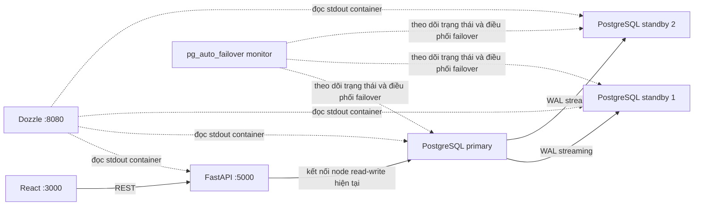

# MeoCinema — Đặt vé và demo hệ thống phân tán

MeoCinema là ứng dụng đặt vé xem phim gồm React/TypeScript (`FE/`), FastAPI (`BE/`), một cụm PostgreSQL 16 ba node và Dozzle để xem log. Dự án minh họa hai vấn đề khác nhau trong hệ thống phân tán:

1. **Consistency (nhất quán):** giữ đúng trạng thái nghiệp vụ khi nhiều request cùng lúc thay đổi dữ liệu. Ví dụ hai khách tranh một ghế thì chỉ một booking được xác nhận; hoàn vé hợp lệ phải trả ghế về trạng thái trống.
2. **Replication (sao chép):** giữ nhiều bản sao PostgreSQL cập nhật từ cùng một luồng ghi để có thể tiếp tục phục vụ sau khi một node lỗi và để kiểm tra dữ liệu đã truyền tới replica chưa.

Hai cơ chế bổ sung cho nhau: replication sao chép các thay đổi đã commit, nhưng tự nó không ngăn hai request đặt cùng ghế. Consistency được bảo vệ bằng transaction và ràng buộc duy nhất ở database; replication giúp các node giữ cùng dữ liệu và hỗ trợ chuyển primary khi có lỗi.

## Kiến trúc



Docker Compose chạy ba PostgreSQL data node, một monitor pg_auto_failover, backend và Dozzle. Frontend chạy riêng bằng npm. Các container nằm trên cùng máy; demo chứng minh hỏng tiến trình/container và failover, không chứng minh chịu được mất cả máy hay mất điện. Monitor là dịch vụ điều phối riêng: khi monitor dừng, PostgreSQL hiện tại vẫn phục vụ và tiếp tục replication nhưng không có quyết định failover tự động mới.

Các thao tác đặt/hoàn vé và phần kiểm tra replication đều dùng PostgreSQL thật. Trong kịch bản đặt ghế, ràng buộc duy nhất ở database là lớp bảo vệ cuối cùng khi request đến đồng thời. Hoàn vé trước giờ chiếu chạy trong transaction, đánh dấu vé đã hoàn và giải phóng ghế; sau giờ chiếu bị từ chối. Cổng thanh toán thật chưa tích hợp, nên “hoàn tiền” là trạng thái nghiệp vụ trong ứng dụng.

## Cơ chế của ứng dụng

1. Trình duyệt lấy danh sách phim và suất chiếu từ API FastAPI.
2. API kết nối tới PostgreSQL node đang nhận ghi. `target_session_attrs=read-write` trong `DATABASE_URL` khiến libpq chọn host đang là primary, thay vì cố ghi vào standby chỉ đọc.
3. Khi đặt vé, backend tạo booking và các dòng ghế trong cùng transaction. Bảng `booking_seats` có ràng buộc `UNIQUE (showtime_id, seat_code)`. Nếu hai request cùng vượt qua bước kiểm tra ban đầu, PostgreSQL vẫn chỉ cho một request chèn cặp suất chiếu/ghế đó; request còn lại bị lỗi trùng khóa, rollback toàn transaction và trả lỗi ghế vừa được đặt.
4. Khi hoàn vé, backend khóa booking bằng `SELECT ... FOR UPDATE`, kiểm tra vé còn trả được và phim chưa bắt đầu, rồi trong một transaction xóa các dòng giữ ghế và chuyển trạng thái booking sang `refunded`. Nếu giao dịch lỗi, rollback giữ nguyên trạng thái cũ.

Vì thế **consistency** ở đây có nghĩa là các request đồng thời vẫn tuân theo quy tắc nghiệp vụ trong database: một ghế của một suất chỉ thuộc tối đa một booking đang giữ. Database là trọng tài cuối cùng; kiểm tra phía giao diện hoặc một biến trong bộ nhớ không đủ khi có nhiều request hay nhiều backend process.

## Vì sao có replication và nó chạy thế nào?

- Chỉ node **primary** nhận ghi. Khi PostgreSQL commit transaction, thay đổi được ghi thành WAL (Write-Ahead Log).
- Hai node **standby** nhận WAL qua physical streaming replication rồi phát lại WAL lên bản sao dữ liệu của mình. `pg_auto_failover` monitor theo dõi trạng thái các node, còn PostgreSQL thực hiện truyền và phát lại dữ liệu.
- Cụm đang dùng synchronous replication với `ANY 1`: primary chờ ít nhất một standby xác nhận WAL trước khi xác nhận commit. Điều này giảm nguy cơ mất các transaction đã xác nhận nếu primary gặp lỗi, nhưng có thể tăng độ trễ hoặc làm ghi chờ khi không còn standby đủ điều kiện.
- Nếu primary dừng, monitor điều phối một standby đủ điều kiện lên primary. Backend kết nối lại qua danh sách ba host và chọn node read-write mới. Trong lúc chuyển vai trò, một số request có thể tạm thất bại.
- Kịch bản replication ghi một event vào primary rồi đọc event ID trực tiếp từ từng node để quan sát WAL đã được áp dụng chưa. Kịch bản failover dừng một container PostgreSQL thật và xác nhận các node còn lại bầu/promote primary mới.

Replication giúp có bản sao sẵn sàng và giảm gián đoạn khi hỏng một node; nó **không phải backup**. Xóa nhầm dữ liệu, lỗi ứng dụng hoặc hỏng toàn bộ máy có thể ảnh hưởng tất cả node trong cụm. Ba node demo chạy cùng một máy nên chỉ minh họa lỗi node/container, không chứng minh chịu được mất máy vật lý.

## Yêu cầu và chạy ứng dụng

Cần Docker Engine, Docker Compose plugin, Node.js và npm. Tại thư mục gốc:

```bash
docker compose up -d --build
docker compose ps
```

Lần đầu, các node lấy base backup; nếu tiến trình đang ở bước `waiting for checkpoint`, PostgreSQL có thể tự tiếp tục sau checkpoint. Đợi `pg-node1`, `pg-node2`, `pg-node3` và `pg-monitor` healthy rồi chạy frontend:

```bash
cd FE
npm install
npm start
```

Mở:

| Thành phần | Địa chỉ |
|---|---|
| Frontend | http://localhost:3000 |
| Backend API | http://localhost:5000 |
| Swagger | http://localhost:5000/docs |
| Health | http://localhost:5000/api/health |
| Dozzle | http://127.0.0.1:8080 |
| PostgreSQL node 1 / 2 / 3 | `localhost:5432` / `localhost:5433` / `localhost:5434` |

Mở Distributed Lab bằng **Ctrl + Shift + L**. Để dừng ứng dụng, dùng `docker compose down`. Lệnh này giữ dữ liệu. Tránh `docker compose down -v` nếu cần giữ database.

## Xem log và trạng thái database

Dozzle là trang đọc log stdout/stderr của container, không phải nơi lưu hay thay đổi dữ liệu database. Mở http://127.0.0.1:8080 rồi chọn `meocinema_pg_node1`, `meocinema_pg_node2`, `meocinema_pg_node3` để xem log PostgreSQL/pg_autoctl; chọn `meocinema_pg_monitor` để xem quyết định trạng thái/failover; chọn `meocinema_backend` để xem lỗi API, booking và refund. Có thể theo dõi log database trực tiếp trong terminal:

```bash
docker compose logs -f --tail=100 pg-node1 pg-node2 pg-node3 pg-monitor
```

Theo dõi cả API và database trong một luồng:

```bash
docker compose logs -f --tail=100 backend pg-node1 pg-node2 pg-node3 pg-monitor
```

Xem lại log gần đây hoặc trạng thái container:

```bash
docker compose logs --since=10m --tail=200 backend pg-node1 pg-node2 pg-node3 pg-monitor
docker compose ps
```

Trong log, `primary`/`secondary` là vai trò node, `WAL`/`LSN` cho biết vị trí dữ liệu đang truyền/phát lại, `base backup completed` là standby vừa lấy bản sao nền, còn `caught-up`/`reached LSN` báo standby đã bắt kịp một mốc WAL. Cảnh báo DNS có thể xuất hiện lúc các container mới nhận địa chỉ mạng; cần xem tiếp trạng thái cuối cùng trong `pg_autoctl show state` để biết node đã về `secondary` hay chưa. Log giúp chẩn đoán, còn truy vấn SQL/API mới xác nhận số dòng dữ liệu.

Xem trạng thái failover do monitor ghi nhận:

```bash
docker compose exec pg-monitor pg_autoctl show state --pgdata /var/lib/postgres/pgaf
```

Xem node nào đang là primary, rồi kết nối `psql` đúng service đó. Sau lần khởi tạo/reset hiện tại, `pg-node2` đang là primary; trạng thái có thể đổi sau failover:

```bash
docker compose exec pg-monitor pg_autoctl show state --pgdata /var/lib/postgres/pgaf
docker compose exec pg-node2 psql -U postgres -d meocinema_db
```

Sau failover, thay `pg-node2` bằng service hiện được báo `primary`. Ứng dụng tự tìm primary nhờ `target_session_attrs=read-write` trong `DATABASE_URL`. Trong psql, xem dữ liệu booking:

```sql
SELECT booking_code, customer_phone, showtime_id, seat_numbers,
       payment_status, created_at
FROM bookings
ORDER BY created_at DESC
LIMIT 20;

SELECT showtime_id, seat_code, booking_id
FROM booking_seats
ORDER BY showtime_id, seat_code
LIMIT 50;
```

Thoát psql bằng `\\q`.

## Tài khoản thử nghiệm

Dùng ba tài khoản khách hàng được tạo trong PostgreSQL sau khi khởi tạo/reset database. Cả ba dùng mật khẩu `MeoTest@2026`; có thể đăng nhập bằng email hoặc số điện thoại. Ba tài khoản phù hợp mở ba phiên riêng để thử đặt cùng một ghế. Không có tài khoản nào được điền sẵn ở màn hình đăng nhập.

| Người dùng | Email | Số điện thoại | Mật khẩu |
|---|---|---|---|
| Khách thử nghiệm 1 | `khach1@meocinema.test` | `0901000001` | `MeoTest@2026` |
| Khách thử nghiệm 2 | `khach2@meocinema.test` | `0901000002` | `MeoTest@2026` |
| Khách thử nghiệm 3 | `khach3@meocinema.test` | `0901000003` | `MeoTest@2026` |

Database hiện đã được reset: 23 phim, 13 suất chiếu, 3 tài khoản, không có booking mẫu hay ghế bị chiếm. Phim dùng poster từ danh sách MoMo của giao diện; trailer placeholder đã bỏ, trailer không có link phù hợp để trống.

Muốn reset lại toàn bộ database, trước tiên xem primary bằng `pg_autoctl show state`, rồi chạy lệnh sau với tên service primary. Lệnh này xóa schema và booking hiện có, sau đó nạp lại dữ liệu ban đầu:

```bash
docker compose exec -T pg-node2 psql -U postgres -d meocinema_db < BE/database.sql
```

Thay `pg-node2` bằng primary hiện tại nếu vai trò đã đổi.

## Kịch bản 1 — Hai khách tranh ghế rồi hoàn vé

Đây là luồng booking thật trong giao diện chính, không phải simulator:

1. Mở MeoCinema trên hai cửa sổ hoặc hai trình duyệt và đăng nhập hai tài khoản/số điện thoại.
2. Chọn cùng phim, cùng suất chiếu và cùng ghế; xác nhận đặt gần như đồng thời.
3. Một khách nhận booking thành công. Request còn lại bị từ chối vì ghế đã được giữ. Xem log backend và kiểm tra `bookings` cùng `booking_seats`; một ghế chỉ được gắn với một booking.
4. Vào **Vé của tôi** bằng tài khoản thắng, xem thời gian đặt và chi tiết vé, rồi bấm **Hoàn vé** trước giờ chiếu.
5. Xác nhận vé chuyển sang **Đã hoàn tiền**, dòng giữ ghế được xóa, ghế xuất hiện lại trên sơ đồ và có thể đặt tiếp. Sau giờ chiếu, backend từ chối hoàn vé.

## Kịch bản 2 — Replication thật và failover một node

Ba data node dùng PostgreSQL physical streaming replication do pg_auto_failover quản lý. Tab **PostgreSQL replication thật** hiển thị role, WAL LSN và trạng thái online bằng cách truy vấn trực tiếp từng node.

1. Đợi trạng thái hiện một primary và hai standby.
2. Bấm **Ghi bản ghi demo vào Primary**, rồi **Kiểm tra trên các node**. Event ID cần được tìm thấy trên cả ba node.
3. Xem primary hiện tại trong Lab. Dừng đúng service đó từ terminal, ví dụ:

   ```bash
   docker compose stop pg-node1
   ```

   Thay `pg-node1` bằng primary đang hiển thị. Đây là lỗi container thật; monitor sẽ chờ timeout an toàn rồi promote standby đủ điều kiện. Trong thời gian chuyển vai trò, một số request có thể tạm lỗi.
4. Đợi tab Lab hiện primary mới. Kiểm tra lại Event ID và bấm ghi một event mới để xác nhận backend đã tìm primary mới.
5. Bật lại node cũ bằng lệnh Lab cung cấp hoặc:

   ```bash
   docker compose start pg-node1
   ```

   Thay bằng node đã dừng, rồi đợi node đó tái gia nhập dưới vai trò standby. `pg_autoctl show state` và trạng thái trong Lab phải trở lại một primary, hai secondary.

PostgreSQL được cấu hình synchronous replication với một standby khi đủ điều kiện, giúp tránh xác nhận commit chưa được standby đồng bộ trong trạng thái bình thường, đổi lại có thể tăng độ trễ hoặc tạm chặn ghi nếu không còn standby đủ điều kiện. Failover không thể bảo đảm giữ một giao dịch chưa được xác nhận; không nên suy diễn khả năng chịu lỗi của cụm demo cùng máy thành cấu hình production.

### Hai kiểu replica khi primary gặp lỗi

- **Ghi đồng bộ:** primary chỉ xác nhận commit sau khi ít nhất một standby xác nhận đã nhận WAL. Độ trễ tăng; nếu standby cần thiết không khả dụng, ghi có thể chờ hoặc lỗi.
- **Đọc từ replica:** standby có thể phục vụ truy vấn đọc, nhưng dữ liệu có thể trễ so với primary. Với thao tác cần đọc ngay booking vừa ghi, ứng dụng cần đọc từ primary hoặc dùng chính sách read-your-writes.

Trong demo này, booking dùng primary để tránh quyết định chỗ dựa trên bản đọc trễ. Lab kiểm tra replication bằng cách đọc trực tiếp từng node.

## API cho kịch bản replication

| Mục đích | Endpoint |
|---|---|
| Vai trò, trạng thái và LSN của từng PostgreSQL node | `GET /api/distributed/replication/real/status` |
| Tạo event thật qua primary | `POST /api/distributed/replication/real/demo-write` |
| Đọc event ID trực tiếp trên mỗi node | `GET /api/distributed/replication/real/verify/{event_id}` |

Các log container ở Dozzle/stdout khác với những endpoint log simulator còn lại của backend.

## Xử lý sự cố

### Backend chưa kết nối được database

```bash
docker compose ps
docker compose logs --tail=100 pg-monitor pg-node1 pg-node2 pg-node3 backend
```

Đợi một primary sẵn sàng; backend có bước chờ database khi khởi động. Có thể kiểm tra API health tại `/api/health`.

### Replica đang khởi tạo base backup

Theo dõi `docker compose logs -f pg-node2 pg-node3` và `pg_autoctl show state`. Không xóa volume khi đang khởi tạo. Dữ liệu mỗi node và cấu hình keeper được lưu trong named volumes.

### Một node bị dừng sau demo

Chạy `docker compose start <service>` và đợi monitor đưa node trở lại cụm. Xác nhận trạng thái có một primary và các node còn lại là secondary trước khi chạy demo kế tiếp.

### Frontend không mở được

Kiểm tra `npm start` còn chạy trong `FE/`, backend ở cổng 5000 và frontend ở cổng 3000.
