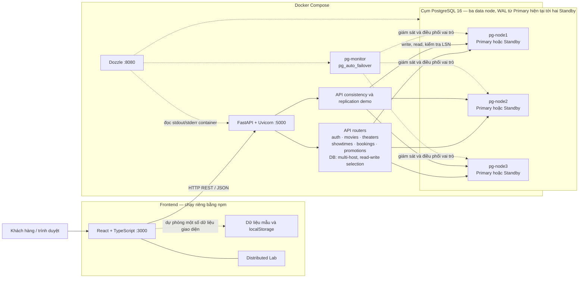

# MeoCinema — Đặt vé và demo hệ thống phân tán

MeoCinema là ứng dụng đặt vé xem phim gồm React/TypeScript (`FE/`), FastAPI (`BE/`), một cụm PostgreSQL 16 ba node và Dozzle để xem log. Hai demo trong Distributed Lab bám vào hai chủ đề Chương 7 của *Distributed Systems*, 4th edition:

1. **Consistency (nhất quán):** demo read-your-writes cho cùng một client logic: ghi trên Primary, quan sát đọc trực tiếp trên Standby, rồi chỉ xác nhận lần đọc sau khi Standby đã replay tới write LSN.
2. **Replication (sao chép):** PostgreSQL truyền WAL từ Primary tới Standby; demo đối chiếu event trên từng node và thử failover.

Hai khái niệm liên quan nhưng khác nhau: replication tạo và cập nhật bản sao; consistency mô tả dữ liệu mà client được phép quan sát và các đảm bảo giữa những lần đọc/ghi. Quy tắc nghiệp vụ đặt cùng một ghế vẫn được bảo vệ riêng bằng transaction và ràng buộc duy nhất trong database.

## Kiến trúc



### Thành phần và cách chúng phối hợp

- **Frontend:** React và TypeScript hiển thị giao diện đặt vé, gọi backend qua HTTP REST/JSON. Một số danh mục có dữ liệu mẫu dự phòng; thông tin giao diện như phiên đăng nhập và trạng thái ghế cục bộ có thể được giữ trong `localStorage`.
- **Backend:** FastAPI chạy bằng Uvicorn, cung cấp API cho đăng nhập, phim, rạp, suất chiếu, combo, khuyến mãi và booking. Router xử lý nghiệp vụ và truy cập dữ liệu PostgreSQL bằng `psycopg2`.
- **Cụm dữ liệu:** `pg-node1`, `pg-node2` và `pg-node3` là ba PostgreSQL data node. Tại mỗi thời điểm, một node giữ vai trò primary nhận ghi; hai node còn lại là standby nhận WAL. Vai trò cụ thể có thể đổi sau failover.
- **Điều phối:** `pg-monitor` chạy `pg_auto_failover`, theo dõi cả ba data node và điều phối promote một standby khi primary gặp sự cố. Backend nhận danh sách cả ba host trong `DATABASE_URL`; `target_session_attrs=read-write` giúp tìm node hiện giữ quyền ghi sau khi vai trò đổi.
- **Distributed Lab:** có đúng hai kịch bản: read-your-writes qua Primary/Standby và kiểm tra physical replication/failover. Cả hai truy cập PostgreSQL thật.
- **Quan sát log:** Dozzle đọc stdout/stderr của các container qua Docker socket ở chế độ chỉ đọc; nó dùng để xem log backend, PostgreSQL và monitor, không phải thành phần lưu dữ liệu nghiệp vụ.

Khi chạy, Docker Compose khởi động backend, monitor, ba data nodes và Dozzle; frontend được khởi chạy riêng bằng npm. Luồng đặt vé đi từ trình duyệt qua API đến PostgreSQL primary. Sau khi transaction được commit, PostgreSQL truyền WAL tới standby. Nếu primary dừng, monitor điều phối đổi vai trò và backend tìm node read-write mới qua cấu hình nhiều host. Các container trong bản demo cùng chạy trên một máy, nên kịch bản minh họa lỗi node/container và failover, không chứng minh khả năng chịu mất cả máy. Nếu monitor dừng, các node PostgreSQL hiện tại vẫn có thể tiếp tục hoạt động và replication, nhưng không có monitor để điều phối failover tự động mới.

### Mô tả kiến trúc để thuyết trình

**Bài nói gợi ý:**

> “MeoCinema có frontend React gửi yêu cầu REST đến backend FastAPI. Backend xử lý nghiệp vụ và ghi dữ liệu vào PostgreSQL Primary. Cụm có ba PostgreSQL node: một Primary nhận ghi và hai Standby nhận WAL rồi replay để cập nhật bản sao. `pg_auto_failover` monitor theo dõi vai trò và điều phối promote Standby nếu Primary lỗi; backend dùng danh sách host để kết nối lại node đang nhận ghi. Distributed Lab có hai demo: một minh họa read-your-writes bằng write LSN và replay LSN, demo còn lại kiểm tra event trên các bản sao và diễn tập failover. Dozzle chỉ giúp xem log. Trong cấu hình trình diễn, các container cùng chạy trên một máy, vì vậy đây là minh họa lỗi node/container, chưa phải kiểm chứng chịu lỗi khi mất máy vật lý.”

**Luồng chính:** `Trình duyệt → React → FastAPI → PostgreSQL Primary → WAL stream → Standby`; `pg-monitor → theo dõi/promote node`; `Dozzle → đọc log container`.

**Phân biệt khi trình bày:** Kịch bản tranh cùng ghế trong ứng dụng kiểm tra một invariant nghiệp vụ bằng unique constraint. Demo consistency của Chương 7 thì ghi trên Primary, đọc trực tiếp trên Standby và dùng write/replay LSN để chỉ xác nhận read-your-writes sau khi bản sao đã phát lại giao dịch.

### Luồng hoạt động và công dụng các thành phần

1. **Người dùng và frontend:** Khách truy cập giao diện React/TypeScript trên cổng `3000`. Frontend hiển thị phim, lịch chiếu và các bước đặt vé; khi cần dữ liệu, frontend gửi yêu cầu HTTP REST/JSON tới backend. Một số dữ liệu mẫu và trạng thái giao diện được lưu ở trình duyệt để làm dữ liệu dự phòng hoặc giữ trạng thái giữa các lần tải trang.
2. **Backend API:** FastAPI trên cổng `5000` nhận yêu cầu từ frontend. Các router phụ trách từng nhóm chức năng như đăng nhập, phim, rạp, suất chiếu, booking, combo và khuyến mãi. Backend xử lý nghiệp vụ rồi dùng `psycopg2` để đọc hoặc ghi dữ liệu PostgreSQL.
3. **PostgreSQL Primary và Standby:** Cụm có ba node `pg-node1`, `pg-node2`, `pg-node3`. Tại một thời điểm, một node là Primary để nhận ghi; hai node còn lại là Standby để nhận bản sao dữ liệu. Backend có cấu hình nhiều host và `target_session_attrs=read-write` để kết nối node hiện có quyền ghi.
4. **WAL streaming replication:** Khi transaction được commit trên Primary, PostgreSQL truyền WAL tới các Standby để cập nhật bản sao. Replication giúp duy trì nhiều bản dữ liệu và cho phép kiểm tra dữ liệu đã tới các node hay chưa.
5. **pg_auto_failover monitor:** `pg-monitor` theo dõi trạng thái của ba node và điều phối chuyển một Standby thành Primary khi Primary gặp sự cố. Backend dùng lại danh sách host để kết nối tới node đang nhận ghi sau khi vai trò thay đổi.
6. **Distributed Lab:** cung cấp đúng hai demo Chương 7: quan sát read-your-writes giữa Primary/Standby và kiểm tra physical replication/failover. Các API truy vấn trực tiếp cụm PostgreSQL.
7. **Dozzle:** Dozzle đọc log stdout/stderr của các container để theo dõi backend, PostgreSQL và monitor khi chạy demo hoặc tìm lỗi. Dozzle chỉ phục vụ quan sát, không lưu dữ liệu nghiệp vụ.

Backend, monitor, PostgreSQL và Dozzle được khởi chạy bằng Docker Compose; frontend chạy riêng bằng npm. Trong cấu hình demo, các container nằm trên cùng một máy, nên việc failover mô phỏng sự cố node/container chứ không mô phỏng mất toàn bộ máy chủ.

Các thao tác đặt/hoàn vé và phần kiểm tra replication đều dùng PostgreSQL thật. Trong kịch bản đặt ghế, ràng buộc duy nhất ở database là lớp bảo vệ cuối cùng khi request đến đồng thời. Hoàn vé trước giờ chiếu chạy trong transaction, đánh dấu vé đã hoàn và giải phóng ghế; sau giờ chiếu bị từ chối. Cổng thanh toán thật chưa tích hợp, nên “hoàn tiền” là trạng thái nghiệp vụ trong ứng dụng.

## Cơ chế của ứng dụng

1. Trình duyệt lấy danh sách phim và suất chiếu từ API FastAPI.
2. API kết nối tới PostgreSQL node đang nhận ghi. `target_session_attrs=read-write` trong `DATABASE_URL` khiến libpq chọn host đang là primary, thay vì cố ghi vào standby chỉ đọc.
3. Khi đặt vé, backend tạo booking và các dòng ghế trong cùng transaction. Bảng `booking_seats` có ràng buộc `UNIQUE (showtime_id, seat_code)`. Nếu hai request cùng vượt qua bước kiểm tra ban đầu, PostgreSQL vẫn chỉ cho một request chèn cặp suất chiếu/ghế đó; request còn lại bị lỗi trùng khóa, rollback toàn transaction và trả lỗi ghế vừa được đặt.
4. Khi hoàn vé, backend khóa booking bằng `SELECT ... FOR UPDATE`, kiểm tra vé còn trả được và phim chưa bắt đầu, rồi trong một transaction xóa các dòng giữ ghế và chuyển trạng thái booking sang `refunded`. Nếu giao dịch lỗi, rollback giữ nguyên trạng thái cũ.

Quy tắc một ghế chỉ có tối đa một booking đang giữ là **invariant nghiệp vụ** được đảm bảo bằng transaction và unique constraint. Đây là vấn đề riêng với consistency models của Chương 7, vốn mô tả thứ tự và khả năng quan sát các lần đọc/ghi trên nhiều bản sao.

## Vì sao có replication và nó chạy thế nào?

- Chỉ node **primary** nhận ghi. Khi PostgreSQL commit transaction, thay đổi được ghi thành WAL (Write-Ahead Log).
- Hai node **standby** nhận WAL qua physical streaming replication rồi phát lại WAL lên bản sao dữ liệu của mình. `pg_auto_failover` monitor theo dõi trạng thái các node, còn PostgreSQL thực hiện truyền và phát lại dữ liệu.
- Compose đặt `synchronous_commit=remote_write`: commit đợi xác nhận standby đã ghi WAL vào hệ điều hành, nhưng không chờ standby replay để dữ liệu nhìn thấy được qua truy vấn. Vì vậy consistency demo đợi replay LSN riêng trước lần đọc được tính là read-your-writes. Cấu hình không bảo đảm standby đã replay ngay khi commit trả về.
- Nếu primary dừng, monitor điều phối một standby đủ điều kiện lên primary. Backend kết nối lại qua danh sách ba host và chọn node read-write mới. Trong lúc chuyển vai trò, một số request có thể tạm thất bại.
- Kịch bản replication ghi một event vào primary rồi đọc event ID trực tiếp từ từng node để quan sát WAL đã được áp dụng chưa. Kịch bản failover dừng một container PostgreSQL thật và xác nhận các node còn lại bầu/promote primary mới.

Replication giúp có bản sao sẵn sàng và giảm gián đoạn khi hỏng một node; nó **không phải backup**. Xóa nhầm dữ liệu, lỗi ứng dụng hoặc hỏng toàn bộ máy có thể ảnh hưởng tất cả node trong cụm. Ba node demo chạy cùng một máy nên chỉ minh họa lỗi node/container, không chứng minh chịu được mất máy vật lý.

## Yêu cầu và chạy ứng dụng

Cần Docker Engine, Docker Compose plugin, Node.js và npm. Tại thư mục gốc:

```bash
docker compose up -d --build
docker compose ps
```

Lần đầu, các node lấy base backup; nếu tiến trình đang ở bước `waiting for checkpoint`, PostgreSQL có thể tự tiếp tục sau checkpoint. Đợi `pg-node1`, `pg-node2`, `pg-node3` và `pg-monitor` healthy rồi chạy frontend:

```bash
cd FE
npm install
npm start
```

Mở:

| Thành phần | Địa chỉ |
|---|---|
| Frontend | http://localhost:3000 |
| Backend API | http://localhost:5000 |
| Swagger | http://localhost:5000/docs |
| Health | http://localhost:5000/api/health |
| Dozzle | http://127.0.0.1:8080 |
| PostgreSQL node 1 / 2 / 3 | `localhost:5432` / `localhost:5433` / `localhost:5434` |

Mở Distributed Lab bằng **Ctrl + Shift + L**. Để dừng ứng dụng, dùng `docker compose down`. Lệnh này giữ dữ liệu. Tránh `docker compose down -v` nếu cần giữ database.

## Xem log và trạng thái database

Dozzle là trang đọc log stdout/stderr của container, không phải nơi lưu hay thay đổi dữ liệu database. Mở http://127.0.0.1:8080 rồi chọn `meocinema_pg_node1`, `meocinema_pg_node2`, `meocinema_pg_node3` để xem log PostgreSQL/pg_autoctl; chọn `meocinema_pg_monitor` để xem quyết định trạng thái/failover; chọn `meocinema_backend` để xem lỗi API, booking và refund. Có thể theo dõi log database trực tiếp trong terminal:

```bash
docker compose logs -f --tail=100 pg-node1 pg-node2 pg-node3 pg-monitor
```

Theo dõi cả API và database trong một luồng:

```bash
docker compose logs -f --tail=100 backend pg-node1 pg-node2 pg-node3 pg-monitor
```

Xem lại log gần đây hoặc trạng thái container:

```bash
docker compose logs --since=10m --tail=200 backend pg-node1 pg-node2 pg-node3 pg-monitor
docker compose ps
```

Trong log, `primary`/`secondary` là vai trò node, `WAL`/`LSN` cho biết vị trí dữ liệu đang truyền/phát lại, `base backup completed` là standby vừa lấy bản sao nền, còn `caught-up`/`reached LSN` báo standby đã bắt kịp một mốc WAL. Cảnh báo DNS có thể xuất hiện lúc các container mới nhận địa chỉ mạng; cần xem tiếp trạng thái cuối cùng trong `pg_autoctl show state` để biết node đã về `secondary` hay chưa. Log giúp chẩn đoán, còn truy vấn SQL/API mới xác nhận số dòng dữ liệu.

Xem trạng thái failover do monitor ghi nhận:

```bash
docker compose exec pg-monitor pg_autoctl show state --pgdata /var/lib/postgres/pgaf
```

Xem node nào đang là primary, rồi kết nối `psql` đúng service đó. Sau lần khởi tạo/reset hiện tại, `pg-node2` đang là primary; trạng thái có thể đổi sau failover:

```bash
docker compose exec pg-monitor pg_autoctl show state --pgdata /var/lib/postgres/pgaf
docker compose exec pg-node2 psql -U postgres -d meocinema_db
```

Sau failover, thay `pg-node2` bằng service hiện được báo `primary`. Ứng dụng tự tìm primary nhờ `target_session_attrs=read-write` trong `DATABASE_URL`. Trong psql, xem dữ liệu booking:

```sql
SELECT booking_code, customer_phone, showtime_id, seat_numbers,
       payment_status, created_at
FROM bookings
ORDER BY created_at DESC
LIMIT 20;

SELECT showtime_id, seat_code, booking_id
FROM booking_seats
ORDER BY showtime_id, seat_code
LIMIT 50;
```

Thoát psql bằng `\\q`.

## Tài khoản thử nghiệm

Hệ thống cung cấp 10 tài khoản khách hàng thử nghiệm được tạo sẵn trong PostgreSQL và bộ nhớ backend. Tất cả 10 tài khoản đều dùng chung mật khẩu `MeoTest@2026`; có thể đăng nhập bằng email hoặc số điện thoại:

| Người dùng | Email đăng nhập | Số điện thoại | Mật khẩu |
|---|---|---|---|
| Khách thử nghiệm 1 | `khach1@meocinema.test` | `0901000001` | `MeoTest@2026` |
| Khách thử nghiệm 2 | `khach2@meocinema.test` | `0901000002` | `MeoTest@2026` |
| Khách thử nghiệm 3 | `khach3@meocinema.test` | `0901000003` | `MeoTest@2026` |
| Khách thử nghiệm 4 | `khach4@meocinema.test` | `0901000004` | `MeoTest@2026` |
| Khách thử nghiệm 5 | `khach5@meocinema.test` | `0901000005` | `MeoTest@2026` |
| Khách thử nghiệm 6 | `khach6@meocinema.test` | `0901000006` | `MeoTest@2026` |
| Khách thử nghiệm 7 | `khach7@meocinema.test` | `0901000007` | `MeoTest@2026` |
| Khách thử nghiệm 8 | `khach8@meocinema.test` | `0901000008` | `MeoTest@2026` |
| Khách thử nghiệm 9 | `khach9@meocinema.test` | `0901000009` | `MeoTest@2026` |
| Khách thử nghiệm 10 | `khach10@meocinema.test` | `0901000010` | `MeoTest@2026` |

Database hiện đã được reset: 23 phim, 13 suất chiếu, 3 tài khoản, không có booking mẫu hay ghế bị chiếm. Phim dùng poster từ danh sách MoMo của giao diện; trailer placeholder đã bỏ, trailer không có link phù hợp để trống.

### Cách 1: Reset nhanh — Chỉ xóa dữ liệu vé, GIỮ LẠI CÁC TÀI KHOẢN (Khuyên dùng)
Dùng script tự động tìm Primary và làm sạch dữ liệu đặt vé phát sinh, giữ nguyên toàn bộ 3 tài khoản khách hàng và danh mục phim:

```bash
./scripts/reset_db_keep_accounts.sh
```

Hoặc chạy lệnh SQL trực tiếp trên node Primary hiện tại:

```bash
docker compose exec -T pg-node2 psql -U postgres -d meocinema_db -c "TRUNCATE TABLE booking_combos, booking_seats, bookings RESTART IDENTITY CASCADE; DROP TABLE IF EXISTS replication_demo_events;"
```
*(Thay `pg-node2` bằng node đang là primary)*

### Cách 2: Reset toàn bộ nạp lại từ đầu
Nếu muốn xóa toàn bộ schema và nạp lại từ đầu từ file SQL:

```bash
docker compose exec -T pg-node2 psql -U postgres -d meocinema_db < BE/database.sql
```

Thay `pg-node2` bằng primary hiện tại nếu vai trò đã đổi.

## Kịch bản 1 — Consistency: read-your-writes qua replica

Chương 7 trình bày consistency models, trong đó **read-your-writes** yêu cầu một client sau khi ghi phải thấy chính lần ghi đó ở các lần đọc tiếp theo. Đọc từ cùng Primary sau commit thường đã thấy dữ liệu, nhưng điều này không nói gì về độ trễ khi client được chuyển sang một Standby.

1. Mở **Distributed Lab** bằng `Ctrl + Shift + L` và chọn **Kịch bản 1: Consistency đọc-sau-ghi**.
2. Bấm **Chạy consistency read-after-write**. Backend ghi event vào Primary và ghi lại write LSN sau commit.
3. Backend đọc trực tiếp trên từng node ngay sau commit. Kết quả có thể đã thấy event hoặc chưa thấy trên Standby; thời điểm chạy và tốc độ replay quyết định điều này.
4. Với Standby, backend chờ đến khi `pg_last_wal_replay_lsn()` đạt write LSN rồi đọc lại event. Chỉ lần đọc sau điều kiện này được tính là read-your-writes đã thỏa trong lần chạy. Nếu timeout hoặc node lỗi, kết quả báo chưa xác nhận.

Cấu hình cụm dùng `synchronous_commit=remote_write`: commit có thể đợi standby nhận và ghi WAL, nhưng không đợi WAL được replay để truy vấn nhìn thấy dữ liệu. Vì vậy demo kiểm tra vị trí replay riêng, không giả định “đã nhận WAL” đồng nghĩa “đã đọc thấy”.

CLI tương đương: `python3 scripts/demo_consistency.py`.

## Kịch bản 2 — Replication thật và Tự động Failover khi Node gặp sự cố

Cụm database gồm 3 data nodes sử dụng **PostgreSQL Physical Streaming Replication** kết hợp **pg_auto_failover** và một node giám sát độc lập (`pg-monitor`).
Tab **PostgreSQL replication thật** (trong modal *Distributed Lab*) hiển thị role, WAL LSN và trạng thái online/offline bằng cách truy vấn trực tiếp từng node theo thời gian thực.

> ⚠️ **QUY TẮC CỐT LÕI (QUORUM RULE):**
> - Cụm 3 node hoạt động theo nguyên tắc đa số (Quorum: cần tối thiểu 2/3 node sống).
> - Khi diễn tập Failover, **CHỈ ĐƯỢC TẮT DUY NHẤT 1 NODE ĐANG LÀ PRIMARY**.
> - **Tuyệt đối không tắt cả 3 node cùng lúc**, vì nếu tắt cả 3 node thì toàn bộ cluster bị sập (Outage), không còn server nào để failover sang. (Nếu lỡ tắt cả 3, chạy: `docker compose start pg-node1 pg-node2 pg-node3` để khởi động lại).

---

### Các bước thực hiện chi tiết

#### Bước 1: Kiểm tra trạng thái cụm trước diễn tập
Chạy lệnh kiểm tra từ Monitor:
```bash
docker compose exec pg-monitor pg_autoctl show state --pgdata /var/lib/postgres/pgaf
```
Hoặc mở giao diện web (`http://localhost:3000`) -> bấm **Distributed Lab (Chương 7)** -> chọn tab **PostgreSQL replication thật**.
Xác định node nào đang giữ vai trò **`primary`** (ví dụ: `pg-node3` hoặc `pg-node1`). Hai node còn lại sẽ có vai trò **`secondary`**.

---

#### Bước 2: Thử nghiệm ghi dữ liệu và đồng bộ Replication (Sync check)
Bấm **"Ghi bản ghi demo vào Primary"** trên giao diện Lab, rồi bấm **"Kiểm tra trên các node"**.
Hoặc chạy lệnh từ terminal:
```bash
curl -s -X POST http://localhost:5000/api/distributed/replication/real/demo-write \
  -H "Content-Type: application/json" \
  -d '{"message": "Kiem tra ghi replication truoc khi failover"}'
```
*Kết quả:* Event ID và WAL LSN xuất hiện đồng nhất trên cả 3 nodes (Node Primary xác nhận sau khi Standby đã nhận WAL).

---

#### Bước 3: Giả lập sự cố chết Node Primary (Simulate Primary Crash)
Tắt đúng container của Node đang là Primary (ví dụ nếu `pg-node3` đang là primary):
```bash
docker compose stop pg-node3
```
*(Nếu primary là `pg-node1` thì thay bằng `pg-node1`)*.

---

#### Bước 4: Quan sát Monitor tự động bầu chọn Primary mới (Automatic Failover)
Chờ khoảng 5-10 giây để monitor phát hiện heartbeat timeout, sau đó kiểm tra lại trạng thái:
```bash
docker compose exec pg-monitor pg_autoctl show state --pgdata /var/lib/postgres/pgaf
```
**Cơ chế diễn ra:**
1. Node bị tắt chuyển sang trạng thái mất kết nối `read-write !` -> `demote_timeout` -> `demoted`.
2. `pg-monitor` tự động chọn Standby có LSN mới nhất (ví dụ `pg-node2`) và cấp lệnh `prepare_promotion` -> `primary`.
3. Standby được promote chính thức thành **Primary mới** (mở cổng ghi).
4. Backend và giao diện web tự động định tuyến các giao dịch ghi mới vào Primary mới mà không cần can thiệp thủ công (Zero Downtime / Zero Manual Intervention).

---

#### Bước 5: Hồi sinh Node cũ (Node Recovery & Re-join)
Khởi động lại container vừa bị tắt:
```bash
docker compose start pg-node3
```
Chờ 3-5 giây và kiểm tra lại:
```bash
docker compose exec pg-monitor pg_autoctl show state --pgdata /var/lib/postgres/pgaf
```
**Kết quả:**
- Node cũ tự động kết nối lại vào cụm dưới vai trò **`secondary` (standby)**.
- `pg_autoctl` thực hiện `catchingup` để đồng bộ bù toàn bộ WAL logs phát sinh trong lúc node bị tắt.
- Cụm phục hồi về trạng thái chuẩn hoàn hảo: **1 Primary mới + 2 Secondary**, LSN giữa các node tiếp tục đồng nhất.

---

### Bảng tra cứu lệnh nhanh cho Kịch bản 2

| Mục tiêu thao tác | Lệnh thực thi |
| :--- | :--- |
| **Xem trạng thái chi tiết 3 node** | `docker compose exec pg-monitor pg_autoctl show state --pgdata /var/lib/postgres/pgaf` |
| **Ghi thử 1 event replication** | `curl -s -X POST http://localhost:5000/api/distributed/replication/real/demo-write -H "Content-Type: application/json" -d '{"message": "Test"}'` |
| **Giả lập chết Primary** | `docker compose stop <node-primary>` *(ví dụ `docker compose stop pg-node3`)* |
| **Bật lại Primary đã dừng** | `docker compose start <node-primary>` *(ví dụ `docker compose start pg-node3`)* |
| **Cứu hộ (khi lỡ tắt cả 3 node)** | `docker compose start pg-node1 pg-node2 pg-node3` |

---

### Hai kiểu replica khi primary gặp lỗi

- **Synchronous replication:** cấu hình node đặt `synchronous_commit=remote_write`; commit đợi standby xác nhận đã ghi WAL vào hệ điều hành. Mức này không đợi standby replay WAL cho truy vấn đọc và không phải cam kết RPO=0 trong mọi kiểu sự cố.
- **Đọc từ replica:** Standby có thể phục vụ truy vấn đọc sau khi replay WAL. Kịch bản 1 so sánh lần đọc tức thời với lần đọc sau khi replay LSN đạt write LSN; read-your-writes được thỏa trong lần đọc sau khi đã chờ điều kiện này.

## API cho kịch bản replication

| Mục đích | Endpoint |
|---|---|
| Vai trò, trạng thái và LSN của từng PostgreSQL node | `GET /api/distributed/replication/real/status` |
| Tạo event thật qua primary | `POST /api/distributed/replication/real/demo-write` |
| Đọc event ID trực tiếp trên mỗi node | `GET /api/distributed/replication/real/verify/{event_id}` |
| Demo read-your-writes: ghi Primary, đọc tức thời và đọc lại sau khi Standby replay tới write LSN | `POST /api/distributed/replication/real/consistency/read-after-write` |

Các log container ở Dozzle/stdout khác với những endpoint log simulator còn lại của backend.

## Xử lý sự cố

### Backend chưa kết nối được database

```bash
docker compose ps
docker compose logs --tail=100 pg-monitor pg-node1 pg-node2 pg-node3 backend
```

Đợi một primary sẵn sàng; backend có bước chờ database khi khởi động. Có thể kiểm tra API health tại `/api/health`.

### Replica đang khởi tạo base backup

Theo dõi `docker compose logs -f pg-node2 pg-node3` và `pg_autoctl show state`. Không xóa volume khi đang khởi tạo. Dữ liệu mỗi node và cấu hình keeper được lưu trong named volumes.

### Một node bị dừng sau demo

Chạy `docker compose start <service>` và đợi monitor đưa node trở lại cụm. Xác nhận trạng thái có một primary và các node còn lại là secondary trước khi chạy demo kế tiếp.

### Frontend không mở được

Kiểm tra `npm start` còn chạy trong `FE/`, backend ở cổng 5000 và frontend ở cổng 3000.
